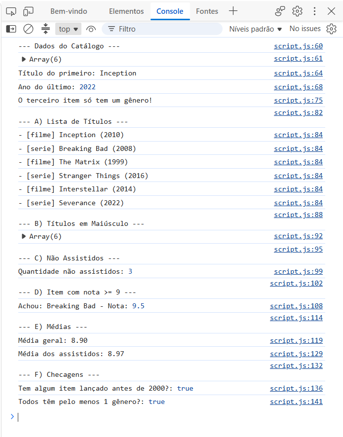
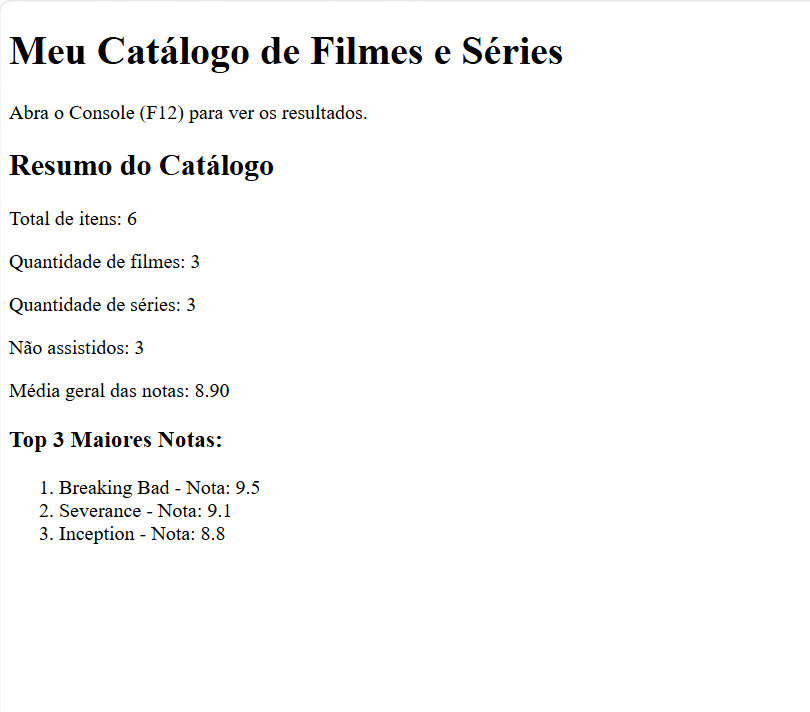

# Atividade Prática - Objetos e Arrays (JSON)

Pedro Cristian de Resende
1364476

# Prints de Execução

# 1. Console do Navegador
Abaixo está o print mostrando a listagem de títulos, cálculo das médias e o resumo das checagens (`some` e `every`):

---

### 2. Resumo na Tela (DOM)
Abaixo está o print da página mostrando o resumo das informações exibido na `div#output`:

